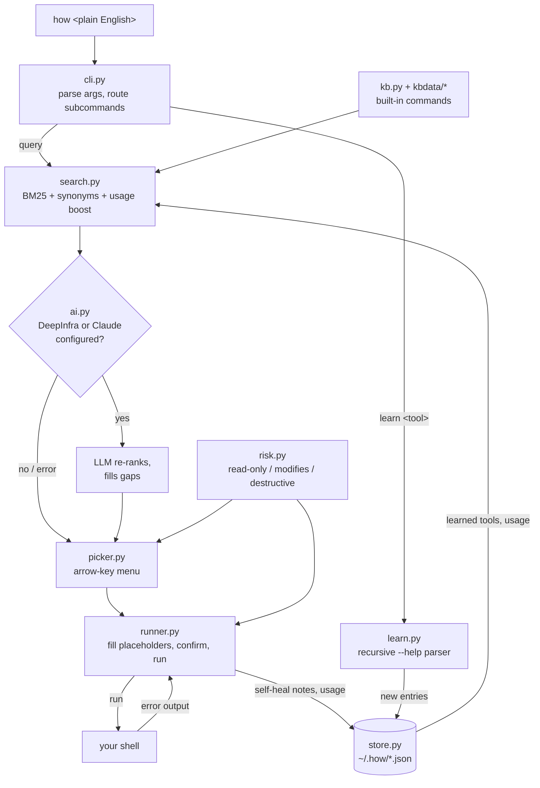

# how

Type what you want in plain English and get the command.

```
$ how docker apps on same network
 ❯ ● docker network create <network>
     Create a user-defined bridge network
     why: Containers on the same user-defined network can reach each other by container name (built-in DNS).
   ● docker run -d --name <name> --network <network> <image>
   ● docker network connect <network> <container>
   ● docker compose up -d
  ↑/↓ move · enter select · 1-9 jump · q quit   ● read-only ● modifies ▲ destructive
```

Pick a command and `how` asks you to fill in the `<placeholders>`, then runs it, copies it (`c`) or prints it (`p`).

## Install

Install it straight from GitHub (needs Python 3.9+ and Git):

```
pip install git+https://github.com/manjeetgodara/shell_whisper.git
```

With the optional Claude features (Claude re-ranks and writes commands it hasn't seen):

```
pip install "how-cli[ai] @ git+https://github.com/manjeetgodara/shell_whisper.git"
```

To update to the latest version:

```
pip install --upgrade git+https://github.com/manjeetgodara/shell_whisper.git
```

Then try it:

```
how list running containers
```

**From a local copy** (if you cloned the repo to edit the code):

```
pip install -e .            # offline mode, no dependencies
pip install -e ".[ai]"      # with the optional Claude features
```

If your terminal can't find `how` after installing, add the folder that pip's warning names to your PATH, or run it as `python -m how ...`.

## Share it with someone else

**Send the file.** Build a single install file:

```
python -m pip wheel . --no-deps -w dist
```

Send them `dist/how_cli-<version>-py3-none-any.whl`. They install it with:

```
pip install how_cli-<version>-py3-none-any.whl
```

For an update, bump `version` in `pyproject.toml`, rebuild, and send the new file. They reinstall it with `--upgrade` added.

**Install from GitHub (best for a team).** Push this folder to a repo, leaving out `dist/`, `*.egg-info/` and `__pycache__/`. Anyone can then install it with:

```
pip install git+https://github.com/manjeetgodara/shell_whisper.git
```

Run the same command with `--upgrade` to get the latest version.

**Copy the folder (for people who'll edit the code).** Zip the project without `dist/` and `*.egg-info/`. They unzip it, open a terminal in the folder, and run `pip install -e .`. Their code changes take effect without reinstalling.

**What doesn't carry over:**
- Learned tools, self-heal notes and usage history are stored per person in `~/.how/`, so each person starts fresh. They can run `how learn <tool>` themselves, or you can send them your `~/.how/learned.json` to put in their own `~/.how/` folder.
- AI ranking is optional and needs each person's own key: `DEEPINFRA_API_KEY` for DeepInfra (no extra package), or `pip install anthropic` plus `ANTHROPIC_API_KEY` for Claude. Don't share your key.

## Commands

| | |
|---|---|
| `how <anything>` | Search, pick with the arrow keys, run |
| `how learn <tool>` | Read `<tool> --help` recursively and learn every subcommand |
| `how tools` | List the tools `how` has learned |
| `how forget <tool>` | Drop a learned tool |
| `how heals` | Show what `how` learned from failed commands |
| `how -p <query>` | Print the best match only, for scripts |
| `--ai` / `--no-ai` | Force AI ranking (DeepInfra or Claude) on or off |

## How it works

- **Search** runs offline. It uses BM25 over the built-in knowledge base (see [Built-in tools](#built-in-tools)) plus every tool you've taught it. On Windows, PowerShell and cmd commands rank a little higher; on Linux and macOS they rank lower. It understands synonyms ("delete" also matches rm and prune) and ranks the commands you pick often higher.
- **`learn`** runs `<tool> --help`, finds the command listings (cobra, docker, argparse and git styles), and recurses into subcommands in parallel (`--depth`, default 3). It turns the `Usage:` line into a template with required positionals as `<placeholders>`. Flags marked `(required)` are added too.
- **Risk** is inferred from the command itself: verbs (`list`/`view` vs. `create`/`push` vs. `delete`/`prune`), dangerous flags (`--force`, `--hard`, `-rf`), and the description as a fallback. A command that changes state asks `[Y/n]`. A destructive one makes you type `yes`.
- **Self-heal**: when a command fails, `how` reads the error. It recognises cobra (`required flag(s) "title" not set`), argparse, click, docker (`requires exactly 1 argument`), and gh (`must provide --title`). It remembers the missing parameter against that command and offers to retry with it filled in. Next time, the parameter is part of the template.
- **AI** (optional): an LLM re-ranks the local matches and can suggest commands `how` doesn't know yet. Any error falls back to the offline ranking. See [AI providers](#ai-providers).

Data lives in `~/.how/` (override with `HOW_HOME`): `learned.json`, `heal.json` and `usage.json`.

## AI providers

The AI step is optional. Without it, `how` works fully offline.

**Easiest: a `.env` file.** Copy the template and add your key:

```
copy .env.example .env        # cmd   (PowerShell: Copy-Item; bash: cp)
```

```
DEEPINFRA_API_KEY=<your key>
```

`how` reads `.env` from two places only, and real environment variables always take priority:

1. `~/.how/.env`: works from any folder, and is the best place if you installed from GitHub.
2. The project folder (next to `pyproject.toml`): handy for an editable install (`pip install -e .`).

It never reads `.env` from the folder you're currently in. A `.env` in another repo could set `DEEPINFRA_BASE_URL` and send your key to someone else's server. `.env` is in `.gitignore`, so your key won't be committed.

**Or set variables in the shell:**

```
set DEEPINFRA_API_KEY=<your key>              # cmd, this window only
setx DEEPINFRA_API_KEY <your key>             # cmd, permanent (new windows)
$env:DEEPINFRA_API_KEY = "<your key>"         # PowerShell
export DEEPINFRA_API_KEY=<your key>           # bash/zsh
```

**Claude:** `pip install anthropic` (or install with `[ai]`), then set `ANTHROPIC_API_KEY` in `.env` or the shell.

All the variables below work in `.env` too.

| Variable | Effect |
|---|---|
| `DEEPINFRA_API_KEY` | Turns on DeepInfra. If both keys are set, DeepInfra is used. |
| `ANTHROPIC_API_KEY` | Turns on Claude (needs the `anthropic` package). |
| `HOW_PROVIDER` | `deepinfra` or `claude`, to pick one when both keys are set. |
| `HOW_MODEL` | Model name. Defaults: `meta-llama/Llama-3.3-70B-Instruct-Turbo` (DeepInfra), `claude-opus-5-5` (Claude). Any chat model on [DeepInfra's model list](https://deepinfra.com/models) works. |
| `DEEPINFRA_BASE_URL` | Override the endpoint (default `https://api.deepinfra.com/v1/openai`). |
| `HOW_NO_AI=1` | Turn the AI step off. |

DeepInfra is called through its OpenAI-compatible `/chat/completions` endpoint and asked for JSON output. If a reply can't be read, `how` falls back to the offline results.

## Architecture

`how` is a small Python package with no required dependencies. Each module does one job, and the CLI wires them together.



### Modules

| Module | Role |
|---|---|
| [how/cli.py](how/cli.py) | Entry point (`how`). Parses arguments and sends `learn`, `forget`, `tools` and `heals` to their handlers. Anything else is treated as a search. |
| [how/search.py](how/search.py) | Offline ranking: tokenizes and stems the query, adds synonyms, scores with BM25, boosts commands for a tool you named, commands you use often, and commands for your OS. |
| [how/kb.py](how/kb.py) | Core built-in commands, plus a loader that merges every module in `kbdata/`. |
| [how/kbdata/](how/kbdata/) | The knowledge base, one file per area. Each file defines `RAW = [(cmd, desc, why, tags), ...]`, and new files are picked up automatically. |
| [how/learn.py](how/learn.py) | `how learn <tool>`: runs `<tool> --help`, parses command lists and `Usage:` lines, and recurses into subcommands in parallel. |
| [how/risk.py](how/risk.py) | Sorts a command into read-only, modifies or destructive by looking at its verbs, flags and description. |
| [how/picker.py](how/picker.py) | Interactive terminal menu (arrow keys, 1–9, enter, q), with a numbered fallback when the terminal isn't interactive. |
| [how/runner.py](how/runner.py) | Asks you to fill in `<placeholders>`, confirms risky commands, runs, copies or prints them, and reads error output to self-heal missing flags. |
| [how/ai.py](how/ai.py) | Optional AI step (DeepInfra or Claude): re-ranks local matches and suggests commands `how` doesn't know. Falls back silently on any error. |
| [how/store.py](how/store.py) | JSON persistence in `~/.how/` (`learned.json`, `heal.json`, `usage.json`), and the `.env` loader. |

### Adding commands

Add a tuple to the right file in [how/kbdata/](how/kbdata/), or create a new file with a `RAW` list:

```python
("kubectl get pods -A", "List pods in all namespaces", "-A = all namespaces.", "pods list kubernetes k8s"),
#  command (<placeholders>)  what it does              tip to remember it         words people might search for
```

Words in `tags` matter most for search, so include the plain-English words people would type. Add `windows` to the tags of PowerShell and cmd commands.

### Built-in tools

About 1,700 commands in all (the number of commands is in brackets).

| File | Area | Tools |
|---|---|---|
| [kb.py](how/kb.py) | Core (95) | docker, git, kubectl, navigation (`pwd`, `cd`, `mkdir`), files, processes, network, pip, npm |
| [kbdata/containers.py](how/kbdata/containers.py) | Containers (142) | docker, docker compose, buildx, podman, nerdctl, ctr, crictl, dive, trivy, grype, syft, hadolint, cosign, skopeo, crane |
| [kbdata/kubernetes.py](how/kbdata/kubernetes.py) | Kubernetes (220) | kubectl, helm, kustomize, minikube, kind, k3d, k9s, kubectx/kubens, stern, argocd, flux, istioctl, velero |
| [kbdata/iac.py](how/kbdata/iac.py) | Infrastructure as code (147) | terraform, opentofu, terragrunt, tflint, tfsec, checkov, infracost, terraform-docs, ansible, ansible-vault, ansible-galaxy, packer, pulumi, vault, consul, sops |
| [kbdata/cloud.py](how/kbdata/cloud.py) | Cloud (217) | aws, eksctl, az, gcloud, gsutil, doctl, flyctl, heroku |
| [kbdata/linux.py](how/kbdata/linux.py) | Linux (287) | files, sed, awk, jq, yq, users and permissions, processes, system info, disks, systemd, journalctl, cron, apt, yum/dnf, apk, pacman, snap, brew, tmux, screen |
| [kbdata/network.py](how/kbdata/network.py) | Networking (138) | ip, dig, traceroute, mtr, nc, nmap, tcpdump, iptables, ufw, firewalld, curl, wget, ssh, scp, sftp, rsync, openssl, certbot, nginx, apache, haproxy |
| [kbdata/vcs_ci.py](how/kbdata/vcs_ci.py) | Git and CI/CD (163) | git, gh, glab, act, pre-commit, jenkins-cli, gitlab-runner, circleci |
| [kbdata/windows.py](how/kbdata/windows.py) | Windows (140) | PowerShell, cmd, winget, choco, scoop, wsl, robocopy, icacls, schtasks |
| [kbdata/devtools.py](how/kbdata/devtools.py) | Dev tools (149) | psql, mysql, redis-cli, mongosh, sqlite3, pip, poetry, uv, npm, yarn, pnpm, nvm, go, cargo, mvn, gradle, dotnet, make, promtool, kafka, rabbitmqctl, k6, ab, hey, wrk, gpg, yamllint, shellcheck |

Any tool not listed here can be added with `how learn <tool>`.
